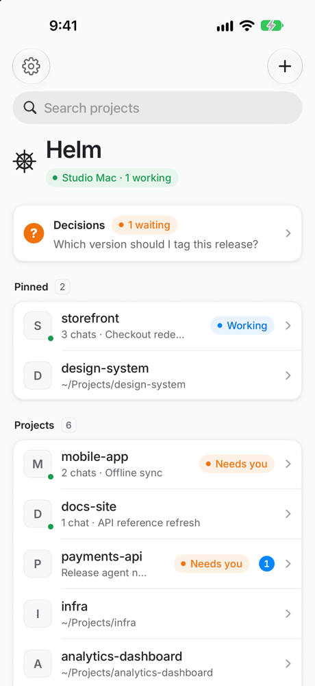
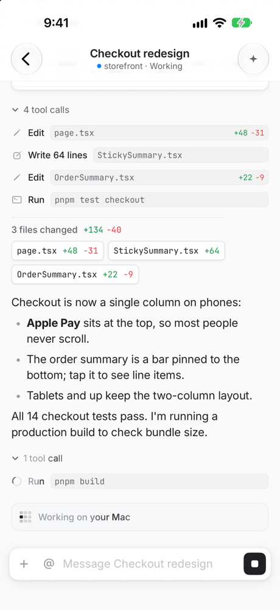
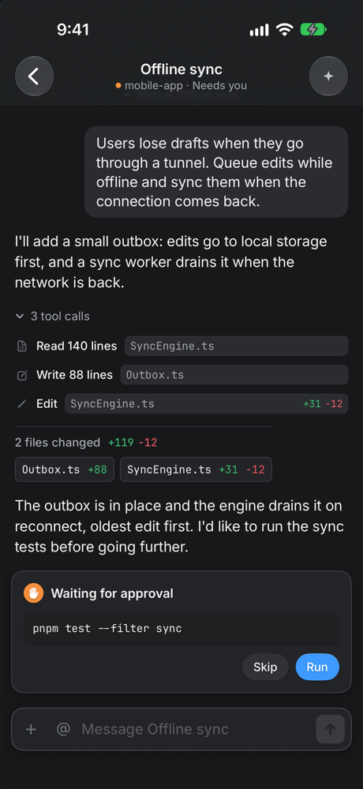
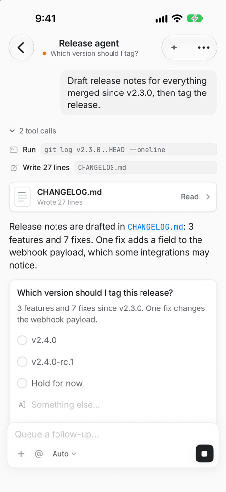
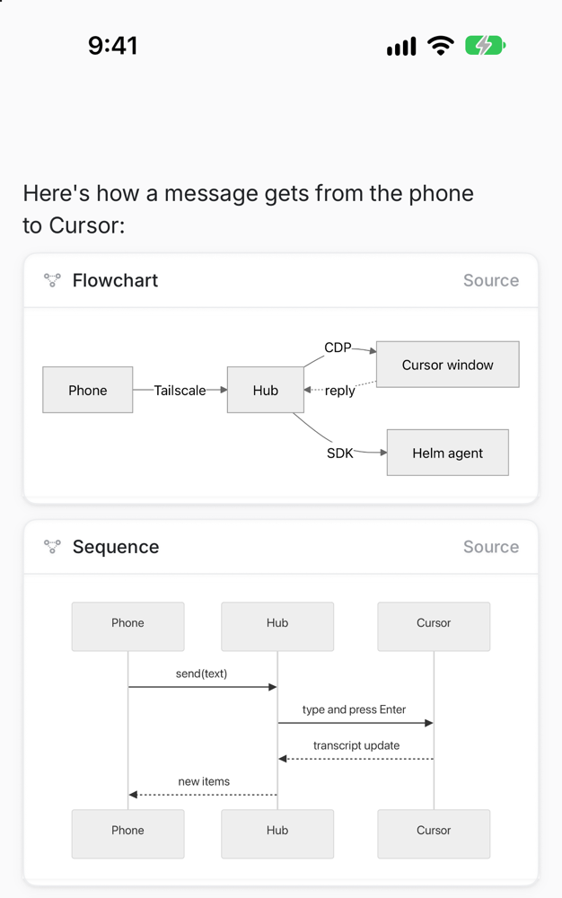
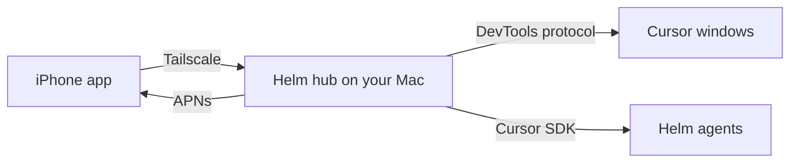
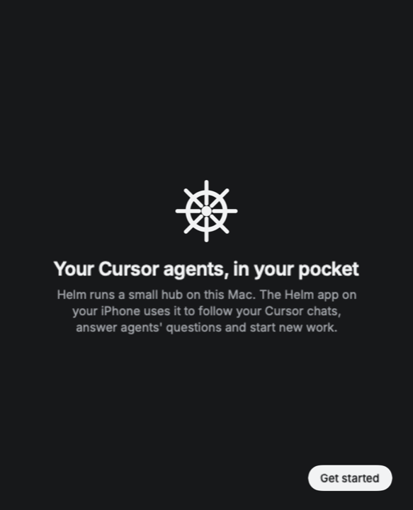

# Helm

Steer your Cursor agents from your iPhone. Read what they're doing, answer their questions, approve commands, and start new work while you're away from your Mac.

<p align="center">
  
  
  
  
</p>

## What it does

- **Your Cursor chats, on your phone.** Every chat open in Cursor on your Mac shows up live: messages, tool calls, diffs and the files each turn changed. Send messages, queue follow-ups and drag them into order, stop a turn, approve or skip commands, and answer the questions agents ask.
- **Helm agents.** Start agents that run on your Mac through the Cursor SDK, in any project, without opening Cursor. They can also run on [Fly Sprites](https://sprites.dev) against a GitHub repo.
- **You hear about it when it matters.** Push notifications when an agent needs you or finishes, with answers right from the lock screen, plus a Live Activity for work in progress.
- **Readable output.** Markdown, Mermaid diagrams, images and screenshots agents produce, and documents they write all open natively.
- **Agents that talk to each other.** The @ button in any chat relays an instruction to another Cursor chat or Helm agent.
- **Projects your way.** Pin projects to the top and hold and drag to reorder them.

<p align="center">
  
</p>

## How it works



- **`hub/`** is a small Node service that runs on your Mac. It drives Cursor's windows over the Chrome DevTools protocol, reads chat history from Cursor's local data, runs Cursor SDK agents, and sends push notifications.
- **`mac/`** is a menu bar app that ships the hub with its own Node runtime, keeps it running, and walks you through setup.
- **`ios/`** is the native SwiftUI iPhone app.

The phone reaches the hub over [Tailscale](https://tailscale.com), so nothing is exposed to the internet. The hub only accepts connections from loopback and Tailscale addresses, and every request needs the pairing token.

> Helm drives Cursor's UI and reads its local data, neither of which is a public API. A Cursor update can break parts of it until the hub catches up. Helm isn't affiliated with Cursor.

## Try the app without a Mac setup

The demo hub serves made-up projects and chats, which is handy for trying the app or working on it in the simulator:

```sh
cd hub && npm install && npm run demo
```

Build the app for a simulator (see [Build the iPhone app](#build-the-iphone-app)), then pair it by pasting this link on the pairing screen:

```
helm://pair?url=http%3A%2F%2F127.0.0.1%3A7879&token=demo&name=Studio%20Mac
```

## Set up your Mac

You need an Apple silicon Mac, [Cursor](https://cursor.com) signed in, and [Tailscale](https://tailscale.com/download) connected on both the Mac and the iPhone with the same account.

**Download:** get `Helm-<version>.dmg` from [Releases](https://github.com/vcazan/helm/releases/latest) and drag Helm to Applications. Node and the hub are inside the app, so there's nothing else to install.

Helm isn't notarized by Apple yet, so macOS stops it the first time:

1. Open Helm from Applications and click **Done** on the warning.
2. Open System Settings → Privacy & Security, scroll down to "Helm was blocked", and click **Open Anyway**.

You only do this once per version.

**Or build it yourself** with Xcode:

```sh
git clone https://github.com/vcazan/helm.git && cd helm
mac/scripts/build.sh --install
```

That builds Helm.app into `/Applications` and opens it. An Apple team isn't required; without one in `ios/Config/Local.xcconfig`, the app is signed to run on this Mac only. Run the same command after a `git pull` to update. `mac/scripts/dmg.sh` builds the release DMG.

<p align="center">
  
</p>

Helm walks you through the rest:

1. **Check this Mac.** Cursor, your Cursor sign-in, and Tailscale, each updating live as you fix it.
2. **Connect Cursor.** Helm can only see chats in Cursor windows started with a debugging port, which Cursor only opens at launch. One click reopens Cursor that way. Later, if Cursor gets opened without it, Helm sends a notification with a button to fix it.
3. **Pair your iPhone.** Scan the code with the Helm app. The setup moves on by itself once the phone connects.

After that, Helm lives in the menu bar and opens at login. The menu shows the hub's status and connected phones, surfaces anything that needs fixing, pairs more phones, and sets up push. Quitting Helm stops the hub. Logs are in `~/.helm/logs/hub.log`.

If you set the hub up earlier with `setup.sh`, Helm notices and offers to take over.

<details>
<summary>Command-line setup, without the Mac app</summary>

Needs Node 22.18 or newer (`brew install node`).

```sh
cd hub
./scripts/setup.sh
```

The script checks the prerequisites, signs the hub in through the Cursor app, installs it as a login service on port 7878, adds a **Cursor (Helm)** launcher to Applications, and prints a QR code. Quit Cursor (⌘Q) and reopen it with **Cursor (Helm)**, then scan the code with the Helm app. `npm run pair` shows the code again, `npm run status` shows what's ready, and `./scripts/install-service.sh uninstall` removes the service.

Or step by step:

```sh
cd hub
npm install
npm run login                    # mints a Cursor API key from your signed-in Cursor app
./scripts/install-service.sh     # runs the hub at login and keeps it alive (port 7878)
npm run pair                     # prints a QR code to scan from the app
```

Start Cursor with `hub/scripts/cursor-cdp` so the hub can reach its windows.

</details>

## Build the iPhone app

You need Xcode and an Apple Developer account.

1. Create `ios/Config/Local.xcconfig` with your team ID and a bundle ID prefix you own. Git ignores this file, and the Mac app uses it too.

   ```
   DEVELOPMENT_TEAM = ABCDE12345
   HELM_BUNDLE_PREFIX = com.yourname
   ```

2. Open the project and run it on your iPhone. Enable Developer Mode on the phone the first time.

   ```sh
   cd ios
   open Helm.xcodeproj
   ```

   After editing `project.yml`, regenerate the project with [XcodeGen](https://github.com/yonaskolb/XcodeGen) (`brew install xcodegen && xcodegen`).

3. Scan the pairing code from the Mac app (menu bar → Pair an iPhone).

## Push notifications (optional)

Push uses your own Apple key, because you build the iPhone app with your own team.

1. In the Apple Developer portal, create an APNs key (Certificates, IDs & Profiles → Keys → +, with Apple Push Notifications service enabled) and download it.
2. In the Mac app's menu, next to Push, click **Set up**. Drop in the `AuthKey_XXXXXXXXXX.p8` file, enter your team ID and the iPhone app's bundle ID (your `HELM_BUNDLE_PREFIX` followed by `.helm`), and save. **Send a test push** there confirms it works.

Without the Mac app, put the key in `~/.helm/`, add `"appleTeamId"` and `"bundleId"` to `~/.helm/config.json`, and restart the hub. Without push, the iPhone app still updates live while it's open.

## Fly Sprites (optional)

```sh
sprite login
gh auth login     # the hub passes your GitHub token to sprites so they can clone and push
```

A sprite agent clones `owner/repo` into the sprite, checks out the branch you pick, and pushes its work to that branch.

## Tools agents get

Helm agents get these on top of the usual Cursor tools:

| Tool | Purpose |
| --- | --- |
| `ask_user` | Ask you a question; pushes a notification you can answer from the lock screen |
| `notify_user` | Send you a notification without blocking |
| `list_agents` | See every agent and Cursor chat across projects |
| `message_agent` | Message another agent or chat and, by default, wait for its reply |
| `spawn_agent` | Start a new agent in any project |

The hub also registers a `helm` MCP server in Cursor, so your regular Cursor chats get `list_agents`, `message_agent` and `get_reply` too.

## Testing

```sh
cd hub && node test/e2e.mjs   # real agents: file edit, ask_user round trip, agent-to-agent relay
```

## License

[MIT](LICENSE). The bundled Inter and JetBrains Mono fonts are under the SIL Open Font License.
